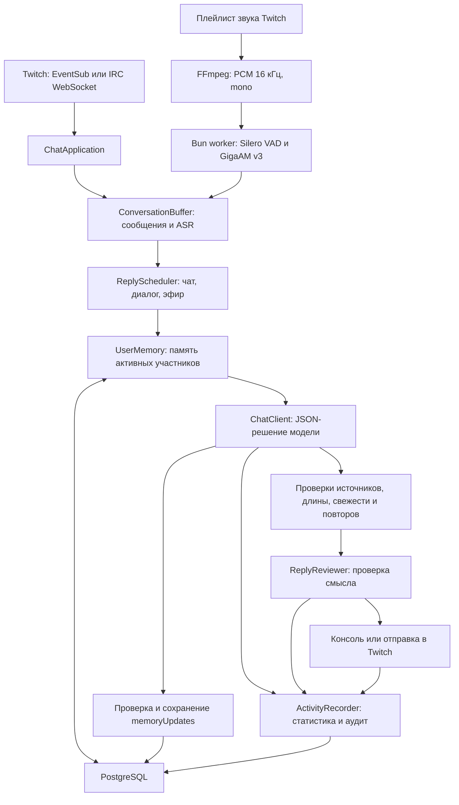

# Устройство сервиса

[README](../README.md) · [Настройки](configuration.md) · [Эксплуатация и разработка](operations.md)

## Поток данных

`twbit` — один процесс Bun/TypeScript, отдельный Bun worker распознавания,
дочерний FFmpeg и PostgreSQL в соседнем контейнере Compose.

Один экземпляр обслуживает один канал из конфига. Подключения чата и звука
независимы. Сообщения чата поступают по подписке, периодического опроса чата нет.
После разрыва соединение восстанавливается, пропущенная история чата не загружается.

## Основные классы

| Компонент | Ответственность |
|---|---|
| `TwitchApplication` | Создание компонентов, запуск, обработка остановки и завершение записи |
| `ChatApplication`, `TwitchApi` | Проверка токена, выбор транспорта, чтение и подтверждённая отправка |
| `WebSocketChatClient` | Жизненный цикл соединения, таймеры и переподключение |
| `SpeechTranscription` | Получение звука, FFmpeg, обмен с worker и восстановление |
| `ConversationBuffer` | Ограниченное окно чата, свежая речь и более ранний фон эфира |
| `BotDialogue` | Точные упоминания и ответы на сообщения собственного аккаунта |
| `ReplyScheduler` | Выбор повода и расчёт его крайнего срока |
| `ReplyAssistant` | Последовательность анализа, проверок, доставки и записи результата |
| `CompactPrompt` | Короткие ссылки на события в запросе, восстановление исходных ID |
| `UserMemory`, `PostgresMemoryStore` | Проверка источников, сохранение и выборка пользовательской памяти |
| `ActivityRecorder` | Ограниченная очередь расхода токенов и истории решений |
| `DailyGreeting` | Одно приветствие при первом подключении за локальный день |

Исходники распределены по `src/clients`, `src/speech`, `src/ai`,
`src/memory` и `src/database`. SQL-миграции находятся в `migrations/`.

## Анализ и доставка

Одновременно выполняется один анализ с проверкой. Новые события, пришедшие
во время запроса, остаются для следующего анализа. Есть три повода:

- `batch` — накопился обычный чат или закончилось время ожидания.
- `dialogue` — пользователь ответил боту через reply либо точно упомянул его ник.
- `stream` — появился свежий законченный фрагмент распознанной речи.

Совпадение автора с предыдущим собеседником само по себе не создаёт `follow_up`.
Команды, спам реакциями и собственные сообщения бота не открывают ускоренный диалог.
Прямые обращения обходят общую паузу между инициативными ответами.

Модель возвращает `reply`, `start_conversation` или `skip` в JSON schemaVersion=1.
Код проверяет связи ID, источник, адресата, длину, уверенность, цитаты и давность.
Отклонённые ответы не обрезаются и не переписываются дополнительным запросом.
Допустимый черновик при включённом `ai.review` проходит ещё один запрос той же
модели с мышлением `low`; у него отдельный учёт токенов.

Ответ на конкретное сообщение использует Twitch reply parent ID. Для начала
разговора добавляется одно `@login`. Доставка считается успешной только после
`is_sent=true` с ID в API либо `USERSTATE` с ID в IRC. Отказ AutoMod, таймаут
подтверждения и ошибка отправки не вызывают автоматический повтор.

## Контекст и доверие к источникам

`chat` содержит исходный текст пользователя. Роль автора канала определяется
метаданными Twitch и логином канала. `stream_audio` — распознавание общего
звука: игра, гости и другие голоса могут попасть в него вместе с автором эфира.
Говорящий помечается `unverified`; аудио не подтверждает личные факты зрителя.

Текущий контекст, более ранняя речь, несколько собственных ответов и
пользовательская память имеют отдельные ограничения. История решений из БД
автоматически целиком в промпт не возвращается. После перезапуска окно разговора
и собственных reply ID начинается заново; долговременная память остаётся в БД.

Память создаётся тем же запросом анализа, в том числе при `skip`. Принимается
до пяти предложений с опорой на новые сообщения того же Twitch user ID.
В БД сохраняются краткая выжимка и цитаты-источники. Это извлечённые утверждения:
сарказм, владение вещами и неоднозначные реплики модель может понять неверно.
Актуальное сообщение пользователя важнее старой памяти.

## Данные PostgreSQL

| Объект | Содержимое и срок |
|---|---|
| `twbit.schema_migrations` | Имена, SHA-256 и время применённых миграций |
| `twbit.ai_requests` | Один запрос анализа или проверки, статус и известный usage; автоматического срока удаления нет |
| `twbit.usage_daily` | Представление расхода по дню UTC, каналу, провайдеру и модели |
| `twbit.reply_history` | Решение, контекст, промпт, проверка, доставка; по умолчанию 30 дней |
| `twbit.user_memories` | Факты на 90 дней и моменты на 14 дней; до 40 записей на пользователя в канале |
| `twbit.daily_greetings` | Резервирование приветствия по каналу, аккаунту и дню; автоматического срока удаления нет |

Очистка истории выполняется при работе writer, при старте и затем раз в час.
Просроченная память не читается и удаляется при очередном сохранении в канале.
Миграции применяются транзакционно под advisory lock; изменение уже применённого
SQL-файла обнаруживается по checksum. Изменения схемы оформляются новым файлом.

## Отказы и границы

При недоступности БД чат и AI продолжают работать. Память может отсутствовать,
а writer хранит до 1000 записей в процессе, из них до 100 записей истории,
и повторяет запись через 10 секунд. Переполнение и аварийное завершение могут
потерять ещё не сохранённые данные. Приветствие без надёжной отметки в БД пропускается.

Ответы AI 401/403 приостанавливают AI до исправления доступа и перезапуска.
429 вводит паузу 60 секунд. Ошибка звука восстанавливается отдельно от чата.
Сервис обрабатывает SIGINT/SIGTERM, завершает свои соединения и ожидает запись.

Приложение не управляет соседними сборщиками чата и не использует MCP для запуска.
При включённом AI выбранные сообщения, ники, user ID, ASR и память передаются
провайдеру из `ai.provider`. История в БД содержит эти тексты, но не ключи,
HTTP-заголовки и скрытые рассуждения модели.
